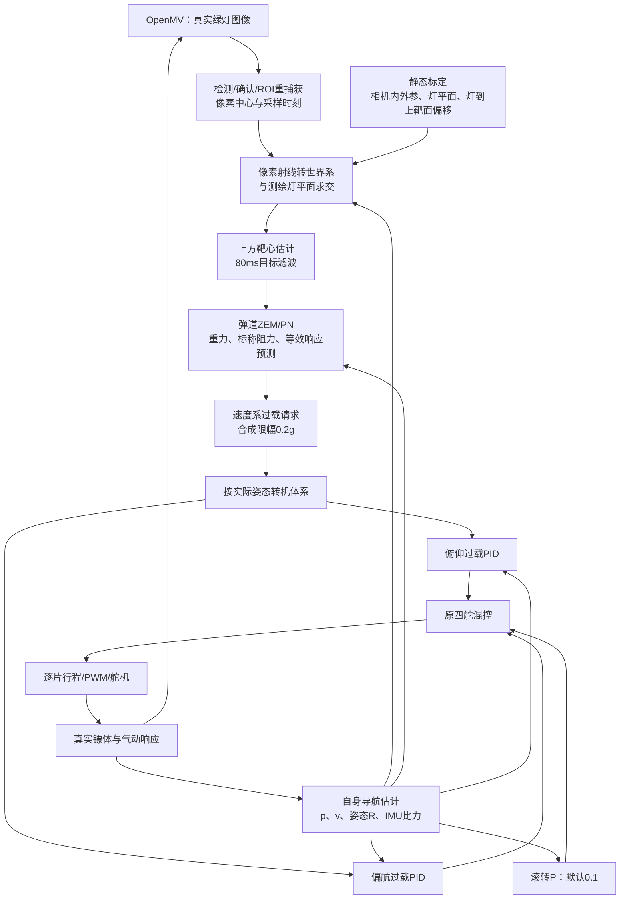

# 当前控制策略、仿真改动与 OpenMV／STM32 移植说明

更新：2026-10-20；2026-10-21 仅同步启动器更名，技术内容沿用原说明。本文对应根目录“运行传统控制仿真.cmd”，参数以 [config.json](D:/WindTunnelSuite/guidance_sim/traditional_control/config.json) 为准。

**现在推荐的是“视觉上靶面估计＋弹道预测 ZEM/PN＋俯仰/偏航过载 PID＋滚转 P”。仿真保留完整刚体、气动、四舵、PWM和舵机动态。它需要新增导引模块，不能只往原 PNG／伪攻角自驾仪里填新系数。**

本文配套新增了`firmware_examples/`参考代码，并做了主机数值/协议测试及ARM对象编译；没有修改桌面Guidedemo/OpenMV原件，没有编译整个原固件工程或烧录板卡。文中的“建议新增”“待修改”仍需在实际固件工程接入。示例代码见第9节。

## 1. 先确认现在运行的是哪一套

| 入口 | 用途 | 目前状态 |
|---|---|---|
| 启动器/运行基线物理仿真.cmd | 原刚体＋视线角速度 PNG＋伪攻角三回路 | 保留作原方案对照 |
| 启动器/运行标准导引仿真.cmd | 有限过载响应的简化运动验证 | 保留 |
| 启动器/运行专家策略仿真.cmd／启动器/运行参考点微调仿真.cmd | 简化运动下的专家及红十字参考实验 | 保留 |
| **运行传统控制仿真.cmd** | **完整物理模型＋预测导引＋真实过载自驾仪** | **当前推荐** |

主验收：随机移动靶，质量±1%、初速±0.1m/s、初始roll±1°、Cd±5%，各项独立均匀分布，每发固定，无横风。64个新随机种子中，原v1控制＋相同修复后视觉命中3/64，增强方案命中64/64；没有运行异常。

这64发的95% Wilson区间为94.34%–100%。它们使用理想自身位置、速度、姿态及估计气动；不能解释为实机已有100%命中率。当前随机移动靶首发在0–0.6s换位，飞镖约1.95s到靶，属于换位后静止命中。更晚换位的末端移动模式此前仅14/32，不应混用成绩。

详细证据：[验收说明](D:/WindTunnelSuite/guidance_sim/outputs/traditional_limit/验收说明.md)。

## 2. 工作区具体改了什么

| 文件 | 改动／职责 | 上板时是否需要移植 |
|---|---|---|
| [traditional_control/simulation.py](D:/WindTunnelSuite/guidance_sim/traditional_control/simulation.py) | 图像反投影、绿灯到上靶面估计、预测器与真实AP桥接；标称模型与真实模型分离；完整回放 | 移植其中观察器、坐标变换、请求接口；MuJoCo和回放部分不用搬 |
| [traditional_control/vision.py](D:/WindTunnelSuite/guidance_sim/traditional_control/vision.py) | 未确认目标前丢失时，下帧恢复全图搜索；保留原阈值和确认规则 | 对仍使用v5逻辑的OpenMV需要对应修复 |
| [traditional_control/config.json](D:/WindTunnelSuite/guidance_sim/traditional_control/config.json) | 独立保存预测参数、两轴PID、滚转、舵机、标称气动 | 整理成固件配置，不是将整个JSON直接烧进去 |
| [traditional_control/run.py](D:/WindTunnelSuite/guidance_sim/traditional_control/run.py) | 启动、真实视觉采样、单项／联合公差随机化及配对评估 | 不移植随机种子和评估器；真实飞行自然存在这些误差 |
| [traditional_control/viewer.py](D:/WindTunnelSuite/guidance_sim/traditional_control/viewer.py) | 波形旁有效PID调参、预测参数页、完整方案导出 | 不移植桌面窗口 |
| [pn_expert_v2/expert.py](D:/WindTunnelSuite/guidance_sim/pn_expert_v2/expert.py) | 复用纯数值弹道预测与ZEM灵敏度决策，不依赖MuJoCo | 需要做C/C++数值移植 |
| [prototypes/guidedemo_control.py](D:/WindTunnelSuite/guidance_sim/prototypes/guidedemo_control.py) | 前期已增加独立轴参数、过载PID、可选滚转角度/角速率环，并修正旧三回路抗积分饱和；新入口在AP边界接收外部过载 | 按需要移植新AP，保留旧类用于对照 |
| [prototypes/flight_sensors.py](D:/WindTunnelSuite/guidance_sim/prototypes/flight_sensors.py) | 统一IMU比力/角速率符号、完整姿态视线传输及渲染像素中心约定 | 移植约定和变换；真实镜头必须实测标定 |
| [prototypes/dart_demo.py](D:/WindTunnelSuite/guidance_sim/prototypes/dart_demo.py) | 加入可选初始roll，只旋转镖体/相机，不改变初速度方向；0°保持原行为 | 不在固件人为随机加roll；用于仿真测试 |
| [prototypes/dart_viewer.py](D:/WindTunnelSuite/guidance_sim/prototypes/dart_viewer.py)、[flight_debug.py](D:/WindTunnelSuite/guidance_sim/prototypes/flight_debug.py) | 第三视角、独立相机、三轴波形、g叠加、回放和性能优化；新入口可选择修复后tracker | 不移植UI；遥测字段可参考 |

实际质量、Cd改变时，预测器仍使用标称m=0.25kg、Cd=0.35；没有把随机误差真值交给预测器。实际舵效、被动气动、30°机械行程、300°/s舵速及20ms PWM保持原设置，没有通过放大控制能力提高命中率。

## 3. 当前控制系统怎么工作



### 3.1 看见绿灯，导引目标却是上方靶面

令相机像素射线为`l_C`，相机到机体旋转为`R_BC`，机体到世界旋转为`R_WB`：

```text
l_C = normalize([(u-cx)/fx, (v-cy)/fy, 1])
l_W = R_WB × R_BC × l_C
p_camera_W = p_body_W + R_WB × camera_offset_B
lambda = (lamp_plane_x - p_camera_W.x) / l_W.x
p_lamp_est_W = p_camera_W + lambda × l_W
p_target_measurement_W = p_lamp_est_W + lamp_to_upper_target_offset_W
```

只接受真实检测、已锁定、检测框未贴边裁切且射线交点在前方的测量，再做时间常数0.08s的EMA：`alpha=1-exp(-dt/0.08)`。**当前实现只估计目标位置，没有单独估计目标速度，也没有读取目标未来换位程序。**

当前静态灯到靶心偏移约为`[+89.740mm, +0.004mm, +79.049mm]`，但实物必须按实际相机/镖体/场地重新测绘，不能把仿真世界坐标直接当实物坐标。

仿真反投影用159.5/119.5对应OpenGL像素索引。硬件应使用对应读出窗口、分辨率、畸变处理方式的实测`fx,fy,cx,cy`；不要机械地给所有OpenMV坐标加0.5，也不要继续把固件中的占位`FOCAL_PX=277`视作标定结果。

**红十字在增强入口只显示。**计算目标使用原始像素中心，不使用“相对红十字误差”作为目标真值。若串口仍传`err_x/err_y`，必须先用双方一致的参考点还原原始中心；否则改红十字会改变解码含义。

### 3.2 导引不是把绿灯钉在画面中心

原PNG按`N×Vc×惯性视线角速度`请求过载。高抛弹道即使本来能命中，视线也会正常变化；持续消除这种变化可能索取远超舵面能力的过载。

现在先预测“后续控制请求为零”时，镖头将在哪里穿过上靶平面，得到二维靶面误差`e`（ZEM）。所谓零请求不等于零重力、瞬间零气动力：预测仍有重力、标称阻力、当前总法向比力及其等效响应。

每次决策预测5条弹道：零请求、俯仰正/负微扰、偏航正/负微扰。当前微扰为0.02g，用中心差分构成`2×2`末端灵敏度矩阵`J`，单位m/g：

```text
u_velocity_g = -(N / 2) × solve(J, e)      N = 3
```

随后做合成圆盘0.2g限幅；矩阵敏感度过小、没有预测到穿靶平面、目标超时或已无剩余修正时间时不继续求大指令。代码实际先检查奇异值再解2×2方程，不是无条件求逆。`N=3`属于这条预测律，不能直接替换原`PngGuidance(4,20,5)`中的4就宣称完成移植。

### 3.3 两个过载自驾仪和一个滚转自驾仪

机体系：`+X向前、+Y向左、+Z向上`；俯仰角/角速率抬头为正，偏航左转为正；过载请求向下/向右为正。

对俯仰或偏航，当前过载PID离散式为：

```text
e = n_cmd - n_measured                        # g
I_trial = clamp(I_old + e*dt, -10, +10)        # g·s
D_measured = (n_measured - n_previous)/dt      # g/s；首次为0
delta_raw = -(Kp*e + Ki*I_trial - Kd*D_measured + Kr*omega_deg_s)
```

若`abs(delta_raw)>30°`且本次积分增量`-Ki*(I_trial-I_old)`使输出更往饱和方向走，则撤回该次积分，重新算输出；最后轴输出限幅±30°。这里的负号来自既定舵效与过载符号，不应单凭曲线反号就全链路翻转。

滚转默认仍是`roll_cmd=-0.1×roll_angle_deg`，且随原视觉有效性门控。**当前不是三套PID。**工作区支持可选角度外环＋角速率内环，但64/64使用的是默认滚转P；切换后应重新验收。

| 参数 | 当前值 | 单位／说明 |
|---|---:|---|
| 预测N | 3 | 两维ZEM决策共用比例 |
| 目标滤波／可信目标超时 | 0.08 / 0.15 | s |
| 预测更新／积分步长 | 0.02 / 0.025 | s；预测步长不是IMU采样周期 |
| 预测请求合成上限 | 0.2 | g；不代表真实舵面保证能输出0.2g |
| 预测等效响应／变化率 | 0.1 / 2.5 | s、g/s；只属于预测模型 |
| 俯仰Kp／Ki／Kd／Kr | 80 / 100 / 0 / 0.1 | °/g、°/(g·s)、°·s/g、s |
| 偏航Kp／Ki／Kd／Kr | 80 / 100 / 0 / 0.1 | 同上，状态各自独立 |
| AP周期／PWM周期 | 0.005 / 0.02 | s，即200Hz控制、50Hz PWM |
| 滚转P | 0.1 | °舵偏/°滚转误差 |
| 标称m／ρ／S／Cd | 0.25 / 1.225 / 0.0033587151005579547 / 0.35 | kg、kg/m³、m²、无量纲 |

三轴混控保持：

```text
servo[0] = +pitch +yaw +roll
servo[1] = +pitch -yaw -roll
servo[2] = -pitch +yaw -roll
servo[3] = -pitch -yaw +roll
```

之后还需逐片舵行程限制。轴分别限30°，相加后单片仍可能超过30°。当前PID抗饱和只看轴输出，不是包含混控与真实舵反馈的完整控制分配抗饱和。

## 4. 核对到的真实固件现状

本次只读核对了`C:/Users/lingard/Desktop/Guidedemo`及`C:/Users/lingard/Desktop/openmv_dart/`。Guidedemo清单中的16个源文件SHA256均与工作区保存的原始清单相同。**桌面有v5、hotfix、v6及main_final.py，尚不能据此判断板内实际烧录的是哪一版。**

| 代码位置 | 实际看到的情况 | 修改含义 |
|---|---|---|
| [guidanceTask.cpp](C:/Users/lingard/Desktop/Guidedemo/Task/Src/guidanceTask.cpp:80) | 旧PNG N=4、Vc=20、请求上限5g；旧AP为Kr0.05、Ka0.5、Ki0.01、30° | 与仿真原v1配置也不同，更不是增强方案；不能混称同一套参数 |
| [CMakeLists.txt](C:/Users/lingard/Desktop/Guidedemo/CMakeLists.txt:66) | 实际编译png.cpp和dart_autopilot.cpp | 目录里存在v2文件不等于正在使用v2 |
| [openmv.h](C:/Users/lingard/Desktop/Guidedemo/Comunication/Inc/openmv.h:27) | STM32收`FF + x_hi x_lo y_hi y_lo w h`共7字节，并等RPDART就绪帧 | 不兼容v5/v6的10字节协议 |
| [guide_v5.py](C:/Users/lingard/Desktop/openmv_dart/guide_v5.py:137)、[guide_v6.py](C:/Users/lingard/Desktop/openmv_dart/guide_v6.py:246) | 发`AA55 + err_x + err_y + area + status + XOR`共10字节 | 同为115200也不能通信；面积不能代替宽/高判断裁切 |
| [openmv.cpp](C:/Users/lingard/Desktop/Guidedemo/Comunication/Src/openmv.cpp:83)、[usart.c](C:/Users/lingard/Desktop/Guidedemo/Core/Src/usart.c:165) | RX是循环DMA，回调却从0重新解析到Size并尝试重启 | 会重复消费、拆包/回卷丢失；应修流式接收 |
| [guidanceTask.cpp](C:/Users/lingard/Desktop/Guidedemo/Task/Src/guidanceTask.cpp:139) | 用到达时间差分视线，再减当前陀螺；无新图时永久保持旧速率 | 需要采样时间对应状态及明确超时 |
| [guidanceTask.cpp](C:/Users/lingard/Desktop/Guidedemo/Task/Src/guidanceTask.cpp:183) | IMU轴映射仍是TODO，直接选gyro[1]/[2]和accel[1]/[0] | 必须先有IMU到体轴的安装变换 |
| [guidanceTask.cpp](C:/Users/lingard/Desktop/Guidedemo/Task/Src/guidanceTask.cpp:59) | PWM启动、写入函数以及主循环调用均被注释 | 当前这份代码只算servo_cmd，没有接通舵机输出 |
| [guidanceTask.cpp](C:/Users/lingard/Desktop/Guidedemo/Task/Src/guidanceTask.cpp:128) | 发射等待及GuidanceTask_Launch实现被注释；握手超时后仍往下走 | 需要重新建立准备／离架／飞行状态 |
| [dart_autopilot.cpp](C:/Users/lingard/Desktop/Guidedemo/Algorithm/Src/dart_autopilot.cpp:33) | 旧抗积分饱和条件没有正确考虑输出前的负号 | 若保留旧对照，需对齐已验证修复；新PID使用独立类 |
| [FusionAHRS.cpp](C:/Users/lingard/Desktop/Guidedemo/Algorithm/Src/FusionAHRS.cpp:90) | 任意非零加计都参与Mahony重力方向修正，静态判断只门控Z陀螺零偏 | 飞行加计不能一直当重力方向 |
| [BMI088.cpp](C:/Users/lingard/Desktop/Guidedemo/BMI088/Src/BMI088.cpp:154) | rad/s量程换算后又乘1.2 | 要核对是否有实测标度依据，不能默认带入新链路 |
| [bsp_dwt.cpp](C:/Users/lingard/Desktop/Guidedemo/BSP/Src/bsp_dwt.cpp:44) | uint64返回值来自32位CYCCNT，未扩展回卷 | 不能因返回类型64位就认为时间永不回卷 |

`dart_autopilot_v2.h`的接口使用rad/s和rad，当前主任务/旧类使用deg/s和deg，而且存在同名类/符号差异。**不要仅改include或把两个同名Autopilot源同时加入CMake。**

## 5. OpenMV 应该怎么改

### 5.1 职责保持在识别与测量

OpenMV负责图像、绿灯检测、跟踪状态和测量时间；STM32负责姿态/导航、目标世界坐标估计、预测导引、自驾仪与PWM。不要在OpenMV额外抵消重力、把舵角当识别误差发送，或用盲推点冒充新测量。

### 5.2 若仍是v5：补未确认失捕回全图

在“速度估计＋ROI更新”的完整`if target ... elif confirmed ...`后增加最终分支：

```python
if target is not None:
    # 保留原实测更新与ROI预测
    ...
elif confirmed:
    # 保留已锁定短丢失的原处理
    ...
else:
    cur_roi = INIT_ROI   # 没检测到且尚未确认：下一帧全图搜索
```

此最小补丁对应本次仿真验证。hotfix/v6已有更完整的恢复逻辑，不应再用v5片段覆盖其状态机。

若进一步将首帧/重捕获时的速度清零、只在相邻实测帧更新速度，这属于额外改进，应另行对照验证；本次64/64没有依赖把整套v6直接替换进来。

### 5.3 v6需要特别区分TRACK与COAST

当前v6默认`COAST_STATUS=STATUS_LOCKED`，盲推期间仍会发送status=1。增强仿真仅用真实检测更新上靶面估计，不能把这类包当作“新实测”刷新150ms有效期。

有两种实现：新协议单独给`detected/locked/predicted`标志；或临时将COAST设为无效并在STM32使用上一可信测量的真实年龄。后者只是过渡，不解决采样时间、框裁切等全部信息缺口。

### 5.4 统一通信协议：建议两端一起升级

建议新增显式版本的数据协议，旧7字节与10字节协议保留为人工选择的兼容模式；不要靠猜测字节长度自动混解析。推荐每张图像发送一次状态包，未检测也发送无效状态，不能用`err=0`表示“目标已居中”。

下面是配套示例采用的**v2测量格式**。两端参考编解码已提供，尚未接入原固件工程；当前仿真也不通过这套真实串口通信：

| 字节偏移 | 字段 | 约定 |
|---|---|---|
| 0–1 | AA 55 | 帧头 |
| 2 | version | 2 |
| 3 | length | 24，含帧头与CRC |
| 4–5 | frame_seq | uint16，小端，每张图像递增 |
| 6–9 | capture_time_us | uint32，小端，相机侧测量时刻；需与STM时钟对齐 |
| 10–11 | u_q4 | uint16，小端，原始中心u×16，保留1/16像素；不是红十字误差 |
| 12–13 | v_q4 | 同上 |
| 14–15 | bbox_w | uint16，小端 |
| 16–17 | bbox_h | uint16，小端 |
| 18 | flags | bit0 detected；bit1 locked；bit2 clipped；bit3 predicted；其余0 |
| 19 | reserved | 0 |
| 20–21 | exposure_us | uint16，小端，本帧曝光设置 |
| 22–23 | CRC16 | 小端，覆盖字节0–21 |

若采用这份格式，CRC固定为CRC-16/CCITT-FALSE：poly=0x1021、init=0xFFFF、RefIn/RefOut=false、XorOut=0；标准文本`123456789`结果为0x29B1。不要假设工程中已有CRC16恰好是同一变种。字段要逐字节打包/解码，避免C结构体填充、大小端或未对齐读造成差异。

`clipped`在OpenMV按原始bbox边界计算；严格复现当前仿真时，框碰到任一画面边缘就不作为可信上靶面测量。`u/v`均为无效时，接收端由flags拒绝，不根据数值零猜测有效性。

这是测量协议，READY、发射通知和相机配置握手需要另有明确命令/应答。当前STM32会等RPDART，但v5/v6脚本没有对应的同版启动握手，必须一并统一。

`capture_time_us`不能直接写UART发送时刻。应记录采图时序并标定曝光/读出延迟；两块MCU时钟也不是天然同源。至少需要测得并补偿固定延迟，完整方案应维护时钟偏移与采样时刻的姿态/导航历史。

## 6. STM32 应该怎么改

### 6.1 新增模块，保留原验证入口

以下是建议的正式固件模块划分；配套示例把PID与解析器合并在`stm32_control_example.h/.cpp`中，导航/观察器/预测模块仍待移植：

| 建议新增 | 输入／输出 |
|---|---|
| `vision_measurement.h/.cpp` | 已校验图像包＋采样时刻自身状态→相机射线、可信上靶面测量及年龄 |
| `own_navigation.h/.cpp` | IMU、离架位置/速度/方向、统一时钟→带时间戳的自身p/v/R、比力 |
| `ballistic_pn.h/.cpp` | 自身状态＋滤波目标＋标称参数→速度系俯仰/偏航g请求及诊断 |
| `overload_pid.h/.cpp` | n_cmd、n_meas、角速率、真实dt→单轴舵角，两个独立实例 |
| `flight_control_config.h` | 当前预测参数、PID、安装矩阵、通道/舵机标定与模式选择 |

保留旧`png.cpp`、`dart_autopilot.cpp`，用明确的`LEGACY_PNG`／`PREDICTIVE_PN`模式选择。新类不要也命名为`Autopilot`。将新源文件加入CMake，先验证新增模式，而不是把旧API的参数语义暗中改掉。

### 6.2 先修接收、时钟与一致快照

`Comunication/Src/openmv.cpp`与头文件需要：

1. 循环DMA只启动一次；回调按`last_pos→Size`的新区间取字节，回卷时分两段。不要每次重读`[0:Size]`或无条件重新启动循环DMA。
2. 把新增字节交给跨回调保留状态的流解析器。DMA一次回调可能是半包、多个包或包尾，不等于一张图像。
3. 校验帧头/版本/长度/CRC、序号、新鲜度、像素范围和flags，再发布完整测量。坏包不刷新可信测量时间；重复序号不当新图。
4. 中断与任务之间用队列、双缓冲或短临界区交换完整样本。多个`volatile`字段不能保证时间、坐标、状态来自同一帧。
5. 图像、IMU与控制使用可处理回卷的单调时间。32位微秒量可做无符号差值，但不能混成当前的“32位周期值转uint64后相减”。

当前IMU固定传1kHz给融合算法、循环却是计算后`osDelay(1)`；控制类似固定dt=0.005后`osDelay(5)`。改为截止时间调度／实测单调dt，并让滤波、积分和预测均使用对应dt，记录实际抖动。

### 6.3 IMU和相机先统一到体轴

把当前`gyro[1]`、`accel[1]`之类TODO替换为显式安装矩阵：

```text
omega_B = R_BS × (gyro_sensor_rad_s - gyro_bias)
f_B = R_BS × (accel_sensor_m_s2 - accel_bias)

omega_pitch_deg_s = -omega_B.y × 180/pi
omega_yaw_deg_s   = +omega_B.z × 180/pi
omega_roll_deg_s  = +omega_B.x × 180/pi

n_pitch_measured = -f_B.z / 9.80665
n_yaw_measured   = -f_B.y / 9.80665
```

这里`R_BS`将传感器坐标转到`前/左/上`机体系；必须先标定，不能默认单位矩阵。相机另有`R_BC`及光心相对重心的偏移，不可用IMU安装矩阵代替。

**加速度计测的是比力`f=a-g`。**过载反馈直接使用变换后的比力，不在AP输入处再扣一次重力。导航更新才使用`a_W=R_WB×f_B+g_W`。静止时向上的加计约为+1g，并不是“静止过载必须为0”；不能在未离架时直接开启飞行零过载闭环来判断舵机正反。

姿态必须明确四元数方向、轴序和yaw零点。当前`yaw_out`上电归零，不等于场地绝对方位；世界射线重建要补上测绘发射方向。用完整旋转矩阵/四元数传输射线，避免仅“俯仰图像差分减一个陀螺值”在roll和离轴时产生假LOS变化。

当前FusionAHRS在飞行比力非零时仍用它纠正重力方向。需要发射前静态标定、飞行段陀螺传播和加计修正可信度策略；不应把仿真的理想姿态成绩当成这份AHRS已经达到的精度。

### 6.4 完整预测导引还缺自身位置/速度

当前制导链没有接入可用的自身`p_W/v_W`导航输出。仅有目标像素和姿态，不足以等价重建本预测器所需的相机世界位置及飞行状态。

建议从已知离架位置、发射方向和**实测离架速度**初始化：

```text
v_W(0) = measured_release_speed × measured_release_direction_W
a_W = R_WB × f_B + [0, 0, -9.80665]
v_W(k+1) = v_W(k) + a_W*dt
p_W(k+1) = p_W(k) + v_W(k)*dt + 0.5*a_W*dt²
```

这是短时导航的起点，不是已经验证好的INS。需要加计标度/零偏、相机杆臂、离架时刻、姿态动态误差的验证；发射架内的大加速度阶段和离架后的积分不能随意混在一起。标称16.747028m/s是仿真基线，不应冒充每发实测速度。

建议增加发射架离架测速来源，并保存图像时间对应的状态历史。速度或姿态估计精度不足时，可以先做旧PN＋新过载AP的分段验证；它有助于检查自驾仪，却不能复现完整预测方案的64/64成绩。

### 6.5 接入新的导引输出边界

修改`guidanceTask.cpp`产生`a_cmd_pitch/a_cmd_yaw`的位置。新模式不再依靠原`q_dot_pitch/q_dot_yaw`调用`png.update()`：

```text
视觉帧到达：
  校验并取对应采样时刻的 p/R/相机光心
  射线与已测灯平面求交，加灯到上靶面偏移
  若实测、锁定、未裁切则更新目标EMA和可信时间

每20ms预测任务：
  读取一致的自身p/v/R/比力、可信目标及年龄
  构造速度坐标系，输入五条弹道预测并计算e、J
  求受限的速度系g请求，变换为机体系g请求
  发布带时间戳的请求；不在串口中断里做弹道积分

每5ms自驾仪任务：
  读取最新请求与本时刻IMU
  更新两个独立OverloadPid；计算滚转P
  三轴混控→逐片标定/限幅→写PWM比较值
```

设`R_WV`为速度系到世界系，速度系仍按前/左/上建立，则请求转换为：

```text
f_cmd_W/g = R_WV × [0, -n_yaw_V, -n_pitch_V]
f_cmd_B/g = transpose(R_WB) × (f_cmd_W/g)
n_pitch_B = -(f_cmd_B/g).z
n_yaw_B   = -(f_cmd_B/g).y
```

预测器输入还需要速度系下的**总法向比力**；它包含机体与舵面气动力，不等于仅舵致比力。实物需由经过标定的IMU转换得到，不能把仿真内部力变量直接当板上已有信号。

### 6.6 移植预测数值内核时保留这些细节

- 参考`BallisticPNExpert.update/_predict/_response/_acceleration`；只移植纯数学，不移植MuJoCo或Python运行时。
- 标称阻力模型使用固定`0.5*rho*S*Cd/m`，重力只加一次；实际m/Cd误差不从试验真值回填。预测中的一阶/变化率响应是近似模型，真实舵机仍由PWM驱动。
- 当前是5条RK4轨迹，穿面位置采用Hermite插值；用粗直线插值替换可能放大末端毫米级偏差。
- 当前机体鼻尖相对重心偏移长度约55.65mm，未来预测中保持当前机体/速度夹角近似；不要误用旧简化模型215mm鼻尖长度。
- `J`需要奇异/病态检查。C实现可用合适的2×2求解与条件检查，不要为了省代码无保护地除以行列式。
- 最大预测时域8s、步长25ms，即每轨迹最多320步；5条RK4最多6400次单轨迹加速度求值，另有响应指数及穿面插值。**尚未测量STM32执行时间**，不能宣称直接搬到200Hz任务一定跑得动。
- C移植优先用相对发射点/相对目标坐标降低float32差分消减；先与Python测试向量对齐。若修改步长、有限差分幅度或插值/矩阵解法，需重新做仿真对照。

### 6.7 接通PWM，并对齐行程语义

当前TIM3/4已配置通道，但`servoStart/servoWrite`及调用被注释。需恢复实际调用并确认初始化顺序、通道/舵面映射、零位、反向与每度脉宽。原注释中的前后/左右称呼不等于已验证接线。

现在`servoPulse()`只把脉宽限在1000–2000us，若10us/°，相当于±50°，不是仿真的±30°。复现当前模型应先对混控后的**每片舵**限到真实标定的±30°，再映射脉宽；按统一1500us、10us/°示例，对应1200–1800us。真实每片舵可以有不同零位、斜率和反向。

仿真舵机τ=0.01s、300°/s是模型参数，不是在板上加一层滤波就自动获得这些硬件性能。先测实际命令到角度响应，再更新模型或调整控制，避免固件与实际舵机重复叠加不明延迟。

### 6.8 超时与离架状态要明确

当前增强仿真有两层有效性，移植时不能混成一个`status=1`：

| 条件 | 当前增强仿真行为 |
|---|---|
| 飞控总开关关闭 | 所有舵请求归零 |
| 真实检测有效，可信目标尚未形成 | 预测请求0；原AP可能按raw检测有效性运行零过载闭环 |
| 可信目标超过150ms，但raw检测仍有效 | 预测请求0；AP可保留积分继续零过载闭环，不等于舵机立即回中 |
| raw有效图像也超过150ms | 俯仰/偏航中立并清控制状态；默认legacy滚转也停止 |

实物建议加准备、等待离架、飞行、结束状态，离架时统一重置时基、目标观察器和AP。若选择“可信目标一超时就全部回中”或“滚转始终独立工作”，这是与当前验收不同的控制策略，需要单独验证，不能默默替换。

## 7. 推荐实际修改顺序与每步验收

| 顺序 | 修改 | 应看到的结果 |
|---|---|---|
| 1 | 确认实际烧录脚本；统一OpenMV/STM32协议和握手 | 原始u/v、状态、序号、时间正确；半包/粘包/坏CRC/回卷不重放旧帧 |
| 2 | 补ROI重捕获，区分实测和COAST；标定内外参 | 未确认时移出小ROI后能够重新锁定；改红十字不改变传出的原始像素 |
| 3 | 标定IMU轴、标度、时基和舵机通道；接通PWM | 单轴转动、单轴舵请求与记录符号一致；实际脉宽/行程符合配置 |
| 4 | 新增两套过载PID，先使用受控输入做单轴验证 | 固定测试向量与Python输出/积分一致；持续限幅不会朝错误方向累积积分 |
| 5 | 实现离架测速和短时自身导航、图像时间对齐 | 自身状态有真实来源；静止目标在相机转动/roll时，重建世界射线仍稳定 |
| 6 | 移植目标观察器及预测PN，保留旧模式 | 同输入的目标估计、ZEM、J、g请求、舵角与Python可对照；耗时满足20ms决策和5ms AP调度 |
| 7 | 用真实硬件测量误差更新仿真并做闭环回放/HIL | 质量、初速、roll、Cd以外的导航/相机/时延/舵效误差进入验收，再评价整链命中率 |

建议日志至少包含：图像seq/捕获及接收时间、detected/locked/clipped/predicted、u/v、目标估计/年龄、p/v/姿态、原始及机体系比力/角速率、预测时间/ZEM/J有效性、速度系与机体系g请求、PID误差/积分/限幅、三轴舵角、四路脉宽、控制实际dt和执行耗时。日志采样应有界且避免每帧阻塞打印拖慢控制。

## 8. 可以直接复用和必须重新获得的内容

可复用：新导引的算法结构、纯数值预测器、两轴PID/AW公式、约定统一后的坐标变换、混控结构、状态/日志字段，以及当前仿真参数作为第一组比较基准。

需要实测或新增：真实运行脚本/协议版本、相机内外参与曝光延迟、IMU安装/标度/零偏和飞行姿态估计、离架速度/时刻、自身p/v导航、实际舵面映射/动态/舵效及场地静态标定。

**先把可观测、可通信、可执行的闭环接通，再将预测导引接入同一过载接口。当前工作区已完成仿真实现和验收；固件完整移植仍是下一项独立实现工作。**

## 9. 配套示例代码：按原工程风格编写

示例位于根目录`firmware_examples/`，保留中文分段注释、构造传参数、`reset/update`接口及简单主循环风格：

| 文件 | 已实现内容 | 接入时仍需做什么 |
|---|---|---|
| [openmv_guidance_example.py](D:/WindTunnelSuite/firmware_examples/openmv_guidance_example.py) | 完整OpenMV测量脚本：QVGA、原v5阈值、ROI修复、确认状态、原始像素、新24字节包与CRC；启动即测量 | 现场标定阈值/内外参/时延；接入同版READY/离架握手。不能直接配旧STM解析器 |
| [stm32_control_example.h](D:/WindTunnelSuite/firmware_examples/stm32_control_example.h) | 新`OverloadPid`、输入输出结构、24字节解析器与任务接入接口 | 将真实安装标定、导航和时钟的数据填入接口 |
| [stm32_control_example.cpp](D:/WindTunnelSuite/firmware_examples/stm32_control_example.cpp) | 两轴PID/AW、默认滚转P、混控后逐片限幅/PWM、CRC和跨半包流解析 | 接真实舵机标定与PWM；当前示例统一1500us/10us每度 |
| [stm32_task_integration_example.cpp](D:/WindTunnelSuite/firmware_examples/stm32_task_integration_example.cpp) | 循环DMA新增区间消费、离架AP重置、5ms控制接入框架 | 实现三个`Platform_*`函数，并提供完整导航/目标观察器/预测PN |

### 9.1 两轴自驾仪最小用法

下面的`a_cmd_pitch_B/a_cmd_yaw_B`必须是已完成坐标转换的机体系g请求；不能直接填像素误差或度数。

```cpp
#include "stm32_control_example.h"

// Kp, Ki, Kd, K_rate, sat；两套对象各自保存积分。
static OverloadPid autopilot_pitch(80.0f, 100.0f, 0.0f, 0.1f, 30.0f);
static OverloadPid autopilot_yaw  (80.0f, 100.0f, 0.0f, 0.1f, 30.0f);

// 每个真实控制周期：所有单位先在输入边界统一。
float pitch_cmd = autopilot_pitch.update(
    a_cmd_pitch_B, omega_pitch_deg_s, n_pitch_measured_g, dt_s);
float yaw_cmd = autopilot_yaw.update(
    a_cmd_yaw_B, omega_yaw_deg_s, n_yaw_measured_g, dt_s);
// 离架/新一轮：两个对象分别调用reset()。
```

完整示例中的`PhysicalAutopilotExample::update()`已经包含raw/可信目标年龄门控、滚转、混控和逐片限幅，实际接入建议用这一层，以免遗漏超时或最终舵限。它不模拟舵机一阶延迟，也不包含弹道预测。

### 9.2 循环DMA回调接法

现有接收缓冲区是`OpenMV`私有成员时，可把以下调用放进原`OpenMV::onRxEvent`，替换“从头解析＋重启DMA”：

```cpp
#include "stm32_control_example.h"

void OpenMV::onRxEvent(uint16_t Size) {
    GuidanceExample_OnCircularDma(rx_buf_, RX_BUF_SIZE, Size);
    // 循环DMA这里不重启；字节解析会跨HAL回调保留半包。
}
```

示例中的`Platform_PublishVisionFromIsr(frame)`由工程实现为ISR可用队列/双缓冲。`capture_time_us`仍是OpenMV时钟，要先对齐再查姿态历史；不能直接与STM32当前时间相减。

### 9.3 三个必须补上的平台接口

```cpp
// 将完整图像包交给任务；不要在IRQ里运行导航/预测积分。
void Platform_PublishVisionFromIsr(const VisionFrameV2& frame);

// 返回本时刻一致的IMU、机体系预测请求、真实测量年龄和离架状态。
// 未离架、导航/请求不可用时返回false，而不是编造p/v或固定返回ready。
bool Platform_ReadControlInput(ControlInputExample& input);

// 结合每片舵的方向/零位/斜率写TIM3/4比较值；按实际预装载策略更新。
void Platform_WriteServoPwm(const uint16_t pwm_us[4]);
```

新源文件加入`target_sources`并将示例目录加入`target_include_directories`。C++对象可编译不代表完整固件可链接：这三个接口、导航、上靶面观察器、完整弹道预测C++内核和握手还没有在本轮替你实现。不要把未定义接口改成“永远ready＋固定N=3的旧PNG”来绕过缺失模块。

### 9.4 示例与仿真并非逐像素完全等价

OpenMV示例为兼容不同blob API，只依赖`rect`，中心定义为`x+(w-1)/2, y+(h-1)/2`；桌面仿真用连通域像素质心，两者可能有偏差。切换后需要按这个中心定义标定相机，并使用实录图像回放验证；不能将示例脚本直接附会成已复现实板64/64。

脚本的采样时间用`snapshot()`调用前后中点作占位，未标定曝光中点，也未与STM32对时。首帧速度门控默认关闭，最小ROI恢复逻辑与本次仿真一致；如果打开额外速度门控，应另做验收。

### 9.5 已完成的代码检查

- ARM交叉编译：两个C++源按Cortex-M4、Thumb、单精度FPU、无异常/RTTI、`-Wall -Wextra -Werror`编译为对象通过；没有链接整份Guidedemo固件，也未烧录。
- C++／Python过载PID对照600步，包含正负饱和及退出饱和：最大舵角差约`3.74e-6°`，积分差约`1.60e-8 g·s`。
- OpenMV打包到C++解析的80帧交叉验证通过，含插入坏CRC帧；序号、像素、尺寸、标志、曝光与时间字段一致。
- 25个拆包位置、坏帧重同步、重复/倒序序号、65535→0回卷、无效测量、超时门控和混控限幅检查通过。
- OpenMV纯函数24项主机检查通过，覆盖CRC标准向量、帧长度、无效包、ROI恢复、确认与两种blob.rect接口。

这些证明参考代码的数值与协议部分可对照，不代表已完成实物相机、USART DMA、任务实时性、导航或舵机闭环验收。测试源码和结果只放在本机`guidance_sim/outputs/traditional_limit/firmware_doc/`，不混进固件示例目录。
